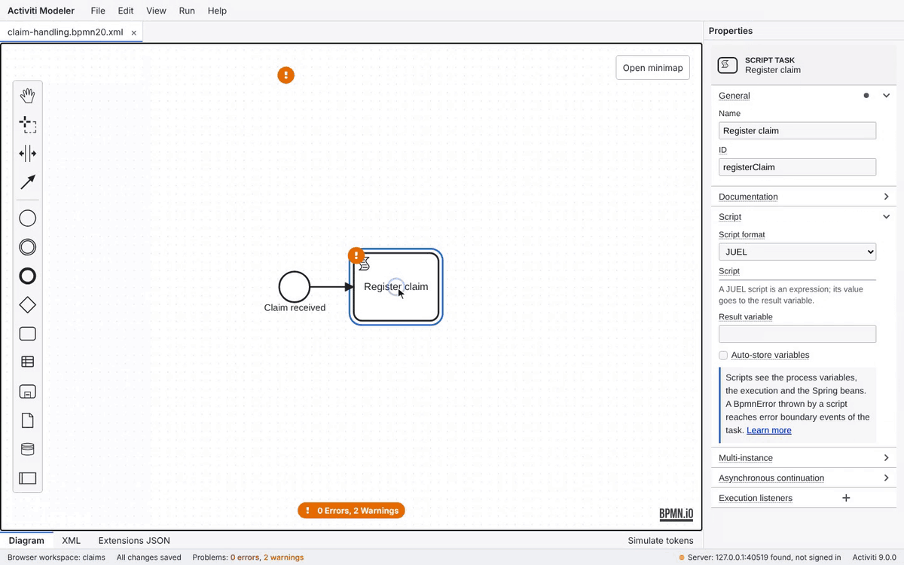
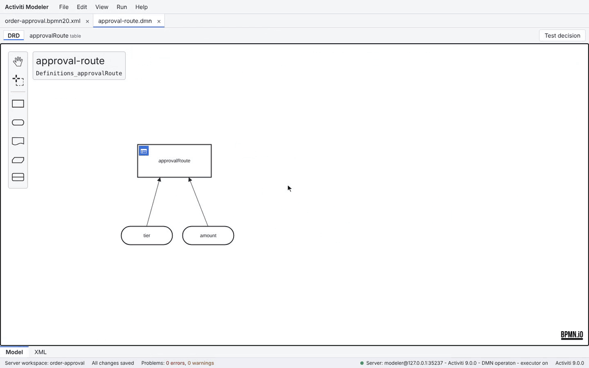
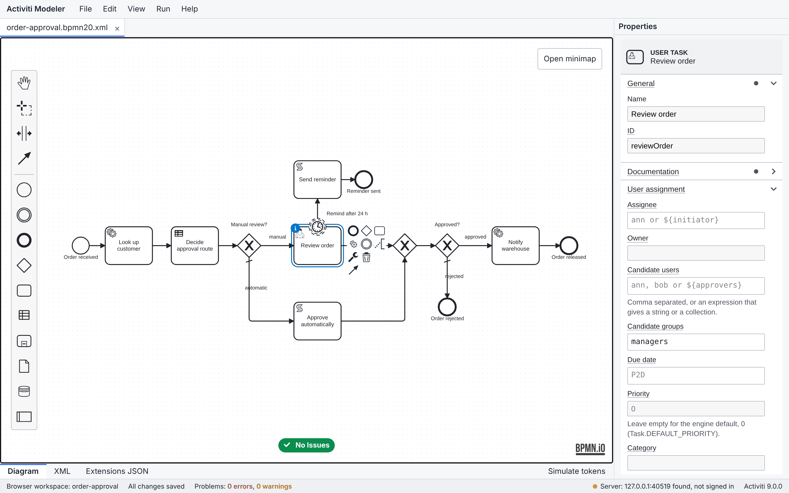
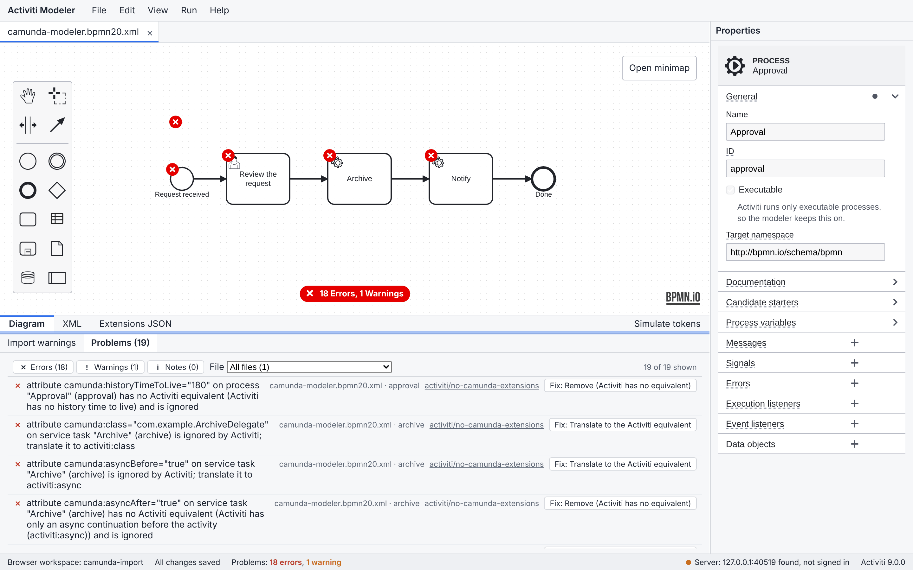
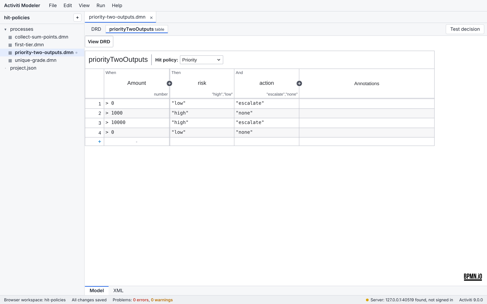
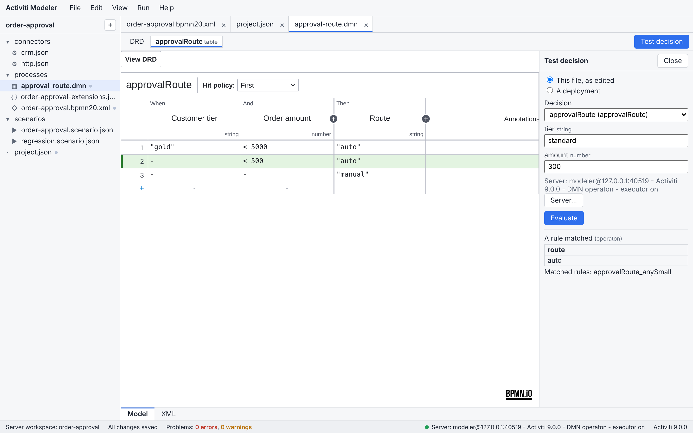
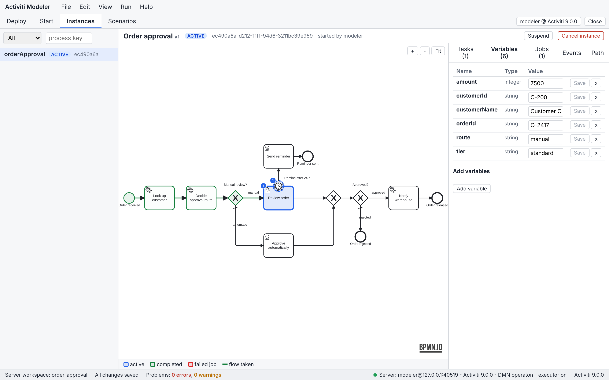
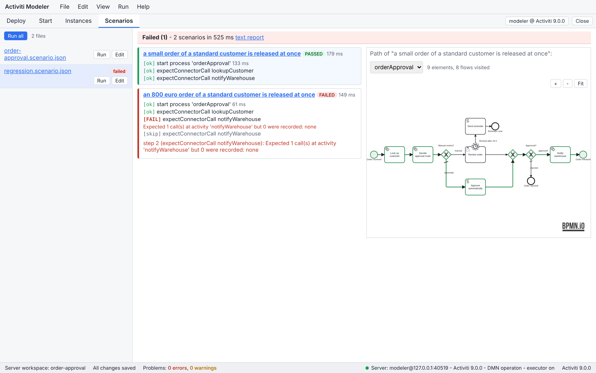
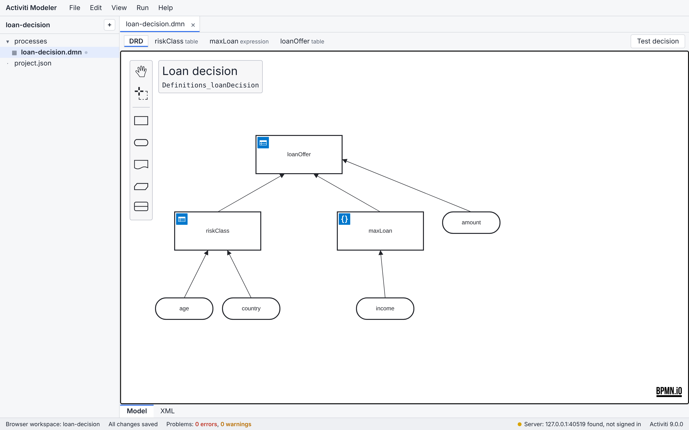
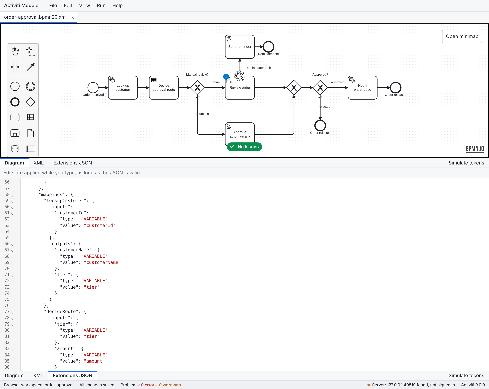

# Activiti Modeler

A BPMN and DMN modeler for Activiti 9 that writes only what the engine executes, and deploys and tests your models on an embedded engine.

[](https://github.com/kleash/activiti-modeler/actions/workflows/ci.yml)

**[Try it in the browser](https://kleash.github.io/activiti-modeler/)** · **[Download](https://github.com/kleash/activiti-modeler/releases/latest)** · [Install guide](docs/user-guide/install.md) · [Documentation](docs/README.md)



## What it does

- **BPMN 2.0 editor** on bpmn-js. The palette and the menus offer only the elements Activiti 9 executes, and the properties panel writes the `activiti:` attributes the engine reads.
- **The extensions file.** Activiti 7 and later read process variables, input and output mappings and constants from `<process>-extensions.json`. The modeler writes it next to each process and edits it in the same panel and the same undo history as the diagram.
- **DMN editor** on dmn-js: requirements diagrams, decision tables with all seven hit policies, literal and boxed expressions, and a decision tester. DMN 1.1 and 1.2 files are migrated when they are opened; saving writes DMN 1.3.
- **Lint while you edit:** 155 rules for what Activiti executes, with quick fixes. Errors block a deployment.
- **Run and test** on the embedded Activiti 9.0.0 of the modeler server: deploy, start instances, complete tasks, send messages and signals, fire timers, follow the path on the diagram, and write, record and run test scenarios.
- **Camunda 7 import:** `camunda:` attributes, listeners, input and output parameters and business rule tasks are translated, with a report of what was dropped and why.
- **Projects are plain files:** in the browser (works offline), in a local folder, in the server's workspace, or as a zip that unpacks into `src/main/resources` of a Spring Boot application.



## Download

The [latest release](https://github.com/kleash/activiti-modeler/releases/latest) has:

| You have | Get | Then |
|---|---|---|
| Windows 10 or 11 (x64) | `activiti-modeler-<version>-windows-x64.zip` | unzip, open `Activiti Modeler\Activiti Modeler.exe` |
| Mac with Apple silicon | `activiti-modeler-<version>-macos-arm64.zip` | unzip, open `Activiti Modeler.app` |
| Mac with an Intel processor | `activiti-modeler-<version>-macos-x64.zip` | unzip, open `Activiti Modeler.app` |
| Linux x64 | `activiti-modeler-<version>-linux-x64.zip` | unzip, run `Activiti Modeler/bin/Activiti Modeler` |
| Java 25 | `activiti-modeler-<version>.jar` | `java -jar activiti-modeler-<version>.jar` |
| Docker | `ghcr.io/kleash/activiti-modeler` | see below |
| Only a browser | <https://kleash.github.io/activiti-modeler/> | model, lint, import and export; running a model needs one of the above |

The desktop bundles bring their own Java runtime. They are not code-signed, so macOS and Windows warn on the first start; the [install guide](docs/user-guide/install.md) says how to open them and how to check a download against `SHA256SUMS`.

## Start in 30 seconds

1. Unzip the bundle for your computer and open **Activiti Modeler**. A small status window appears and your browser opens the modeler. If it asks you to sign in, use `modeler` / `modeler`.
2. **File > New file**, choose **User task approval** and give it a name.
3. **Run > Deploy project**, then **Run > Start instance**. The instance opens with its path on the diagram; claim and complete the task in the **Tasks** panel and the instance ends.

With Docker instead:

```bash
docker run --rm -p 127.0.0.1:8080:8080 -v activiti-modeler-data:/data ghcr.io/kleash/activiti-modeler
```

Open <http://localhost:8080> and sign in as `modeler` with the password the container prints. The projects are kept in the volume.

## Coming from Camunda Modeler

Camunda Modeler writes for the Camunda engines. Used for an Activiti project, three things go wrong:

| | Camunda Modeler | Activiti Modeler |
|---|---|---|
| **Extensions** | `camunda:` (Camunda 7) or `zeebe:` (Camunda 8). Activiti does not read `camunda:` attributes: a service task with `camunda:class` fails to deploy (`SERVICE_TASK_MISSING_IMPLEMENTATION`), and an assignee, candidate group, due date, form key, initiator, input and output parameters, async flags or result variable are dropped without a message. Only a few child elements, such as `<camunda:taskListener>`, are still read, because Activiti matches them by local name. | `activiti:` only. A file with Camunda or Zeebe extensions cannot be saved until it is converted, and the conversion reports what it changed. |
| **Extensions file** | Not written. Without a mapping in `<process>-extensions.json`, the variables a user task is completed with, the outputs of a connector, what a called process returns and message payloads do not reach the process. | Written and edited with the diagram. New user tasks, call activities and message catch events get a default mapping (`MAP_ALL`, or `MAP_ALL_OUTPUTS` on a multi-instance user task). |
| **Lint** | bpmnlint plus Camunda's compatibility rules for its own engines. | 155 rules for what Activiti executes. The 78 that mirror Activiti's own validator run through that validator on every build and agree with it on every fixture. |

Evidence, each with the test that shows it: findings N01.2 and 1 and the validator mirror in the [engine findings](docs/engine-findings.md), finding 1 of the [compatibility check](compat-check/README.md), and [ADR 0006](docs/adr/0006-extensions-store.md). To bring existing files over, see [Importing a Camunda 7 model](docs/user-guide/camunda-import.md).

## How it is tested

Counted in this repository:

| What | Count |
|---|---|
| Corpus projects, each with a reference model and hand-written oracles (C01 to C22, with three projects each for C17 and C20) | 26 |
| Scenarios: start, steps, expected path, variables and tasks | 316, plus 80 decision cases |
| Corpus projects the modeler rebuilds and runs against the same oracles | all 26 through its test API; 7 of them also with mouse and keyboard in the real UI |
| Negative models, each with its expected lint result and engine outcome (`corpus/N01-negative`) | 53 |
| Lint rules | 155, of which 78 mirror Activiti's validator and are checked against it |
| Playwright tests | 591 on the production build, 44 against the real modeler server, and the 33 corpus builds |

- Every project runs on embedded Activiti 9.0.0 in its own Spring context and H2 database, once through Spring auto-deployment and once through a `DeploymentBuilder`. The scenarios assert paths, variables, task assignments, mappings and DMN results, not only that a model deploys. Together they must visit every flow node and sequence flow of a project, or name the exemption and the reason.
- A project the modeler rebuilt must be semantically equal to the reference model before it runs. The oracles are never generated.
- CI runs the same corpus on Activiti 8.8.1 with JDK 21. The hand-written corpus also runs through the modeler server's REST API with the async executor on.
- `scripts/verify-all.sh` runs all of the above; CI runs the same script on Spring Boot 3.5.16 and 3.5.7. The Playwright suites run without retries.

The status of every feature is in the [feature matrix](docs/FEATURE_MATRIX.md), and the tests behind each row are in the [verification index](docs/verification-index.md).

## Screenshots

<table>
<tr>
<td width="50%"><br><sub>The properties panel with the attributes Activiti reads</sub></td>
<td width="50%"><br><sub>A Camunda Modeler file: every <code>camunda:</code> attribute flagged, with a fix</sub></td>
</tr>
<tr>
<td><br><sub>DMN decision tables, every hit policy</sub></td>
<td><br><sub>Test a decision on the engine; the matched rule is highlighted</sub></td>
</tr>
<tr>
<td><br><sub>A running instance: active task, path taken, variables you can edit</sub></td>
<td><br><sub>Scenarios run on the engine: a report per step and the path taken</sub></td>
</tr>
<tr>
<td><br><sub>Decision requirements diagrams</sub></td>
<td><br><sub>The <code>-extensions.json</code> file, written for you</sub></td>
</tr>
</table>

More: [token simulation](docs/images/showcase/token-simulation.gif), [running scenarios](docs/images/showcase/scenario-run.gif), [deploy result](docs/images/showcase/deploy-result.png), [connector templates](docs/images/showcase/element-templates.png), [XML view](docs/images/showcase/xml-view.png).

## Runs on

| Activiti | JDK | Spring Boot | |
|---|---|---|---|
| 9.0.0 | 25 | 3.5.x | the modeler server, the desktop bundles and the Docker image run on it |
| 8.8.1 | 21 | 3.5.x | for applications that embed the libraries; the whole corpus runs on it in CI |

Your application needs nothing from this project to run what the modeler exports: the BPMN 2.0 files, the `-extensions.json` files and the DMN files run on Activiti's own `activiti-spring-boot-starter`. The one exception is DMN decision tasks. Activiti 7 and later have no DMN engine, so a project that uses them adds `activiti-dmn-connector`. Do not share a database between the two lines: Activiti 9.0.0 cannot open a database that 8.8.1 has written to. Details are in the [integration guide](docs/integration-guide.md).

## Libraries on Maven Central

The Java modules below are published to Maven Central with each release, starting with 0.1.0, under the group `io.github.kleash.activiti`, with sources, javadoc and GPG signatures. They are Java 21 bytecode and run on both Activiti lines.

| Artifact | What it is |
|---|---|
| `activiti-dmn-connector` | runs the DMN decisions of decision tasks (Operaton DMN); the one module an exported project may need |
| `activiti-dmn-connector-kie` | the KIE DMN engine instead, for boxed expressions and business knowledge models |
| `activiti-scenario-runner` | runs the modeler's `*.scenario.json` files in your own JUnit tests |
| `activiti-runtime-rest-core` | a REST API over the running engine that brings no security of its own |
| `activiti-runtime-rest-dev` | the development endpoints of the modeler server (validate, deploy, run scenarios, workspace files); not for production |
| `activiti-modeler-server` | the modeler server; the classifier `exec` is the runnable jar of the downloads |

```xml
<dependency>
  <groupId>io.github.kleash.activiti</groupId>
  <artifactId>activiti-dmn-connector</artifactId>
  <version>0.1.0</version>
</dependency>
```

Activiti 8.x and 9.x themselves come from the Alfresco repository, which your pom still needs; the [integration guide](docs/integration-guide.md) has the snippets.

## Build from source

```bash
git clone https://github.com/kleash/activiti-modeler.git
cd activiti-modeler
./build.sh        # Windows: build.cmd
./run.sh          # Windows: run.cmd
```

You need git and a shell. `build.sh` downloads JDK 25 when `java` is older, Maven through the wrapper and Node through Maven; the first build downloads about 500 MB. To work on the code, read [CONTRIBUTING.md](CONTRIBUTING.md) and the [developer guide](docs/developer-guide.md).

## Roadmap

- An embeddable Spring Boot starter: the modeler inside your own application, over the processes it has deployed, read-only or for editing, without the deploy endpoints.
- A runtime cockpit for the instances, tasks and jobs of a running application.
- Spring Boot 4 and Spring Framework 7, once a stable Activiti release supports them.

## Documentation

- [Documentation index](docs/README.md)
- User guide: [install](docs/user-guide/install.md), [modeler basics](docs/user-guide/modeler-basics.md), [running and testing](docs/user-guide/running.md), [scenarios](docs/user-guide/scenarios.md), [DMN](docs/user-guide/dmn.md), [lint rules](docs/user-guide/lint-rules/index.md), [modeler server](docs/user-guide/modeler-server.md)
- [Integration guide](docs/integration-guide.md): run exported projects in your own Spring Boot application
- [Changelog](CHANGELOG.md)

Help and questions: [SUPPORT.md](SUPPORT.md). Contributions: [CONTRIBUTING.md](CONTRIBUTING.md) and the [code of conduct](CODE_OF_CONDUCT.md). Vulnerabilities are reported privately: [SECURITY.md](SECURITY.md).

## Licence

Apache License 2.0: [LICENSE](LICENSE) and [NOTICE](NOTICE). The licences of everything the downloads bundle are in [THIRD-PARTY-NOTICES.md](THIRD-PARTY-NOTICES.md).

The modeler is built on [bpmn.io](https://bpmn.io) (bpmn-js and dmn-js), whose licence requires the bpmn.io watermark to stay visible on every rendered diagram. The modeler shows it on every canvas, and a Playwright test fails when anything covers it. Keep it visible if you change or redistribute the modeler.
